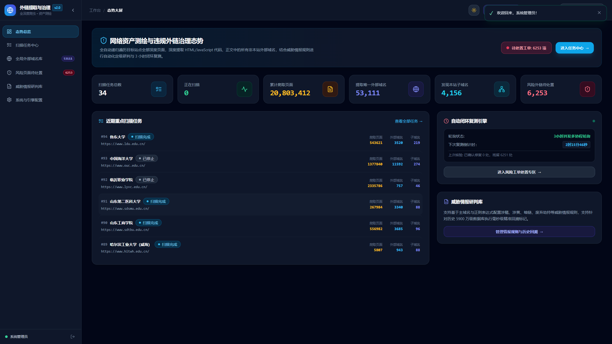
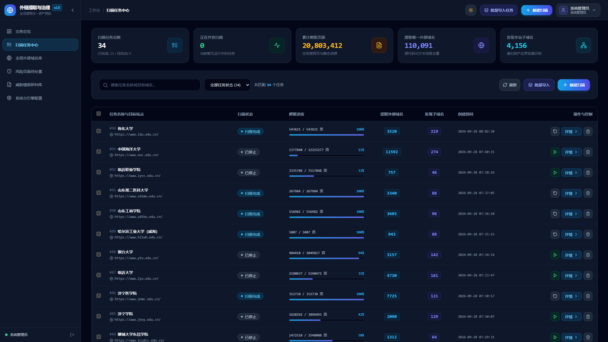
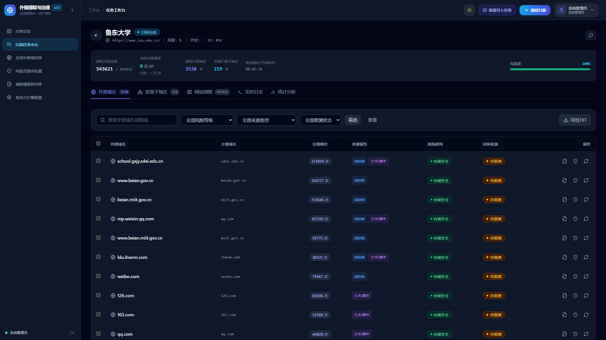
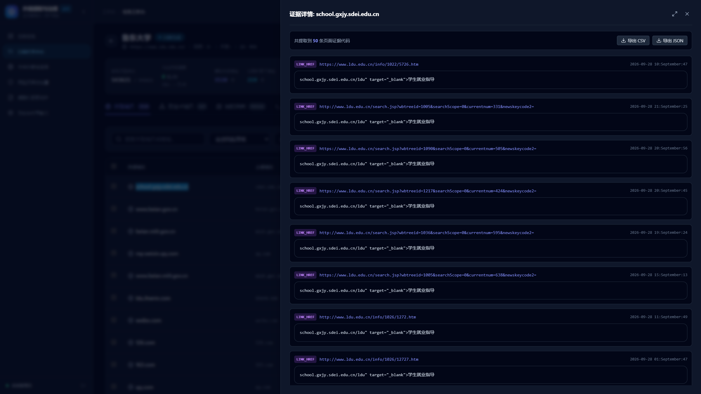
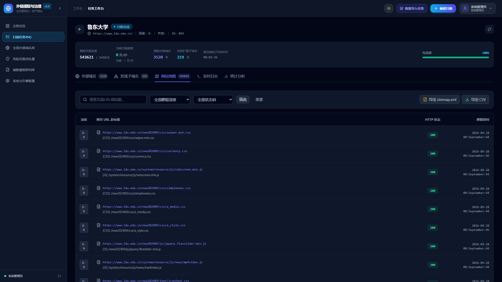
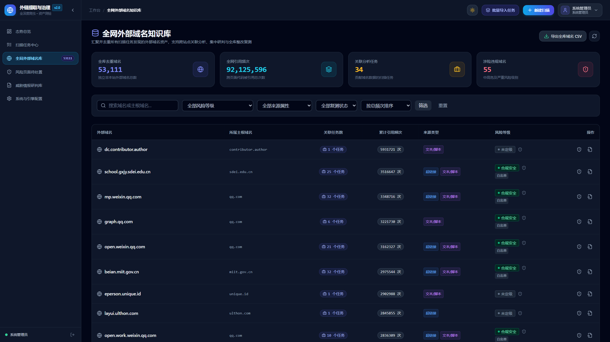
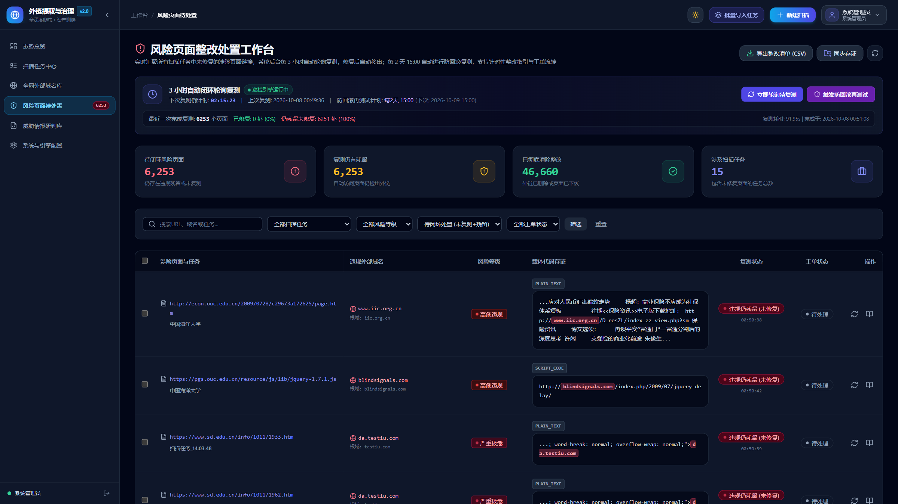
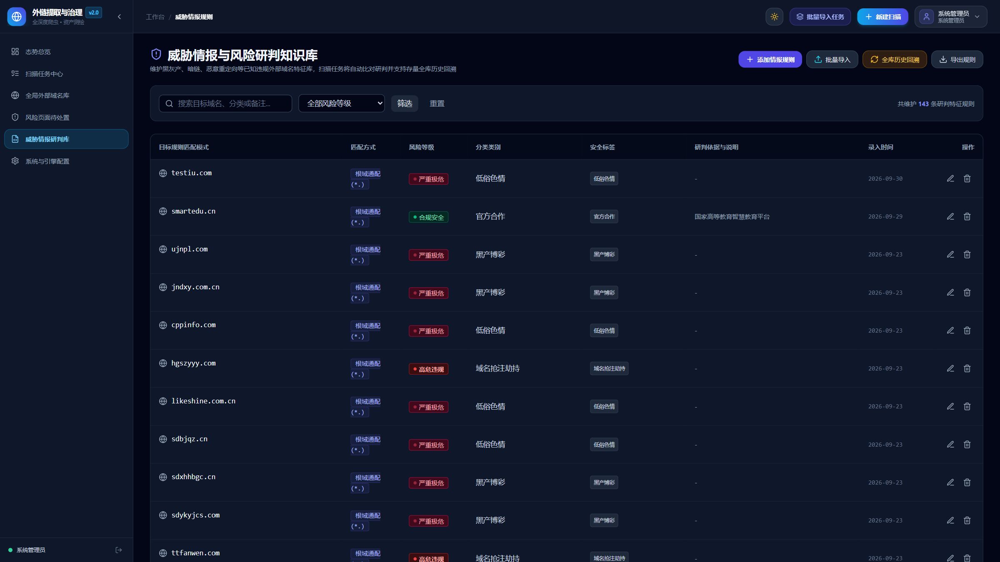
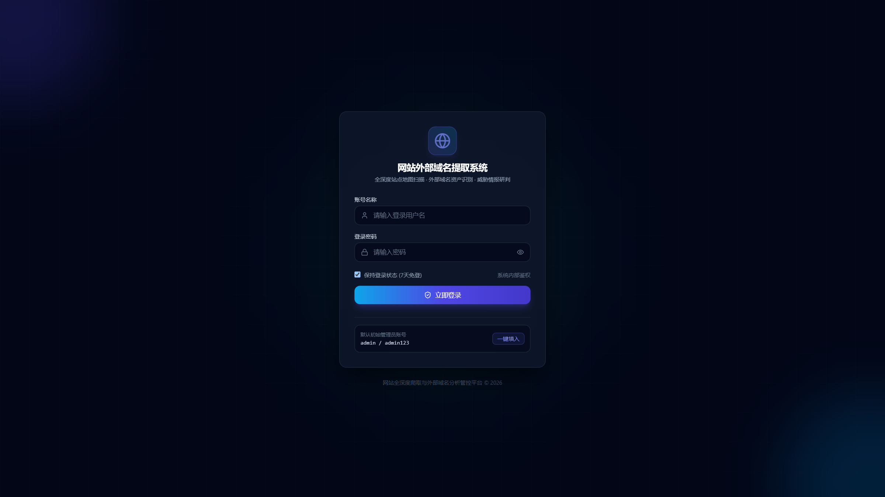

# 网站全深度网站地图扫描与外部域名（链接+文本代码）提取系统

一套高效、精准的自动化网站全深度爬虫与外部依赖域名探测分析系统。系统能够自动对目标站点进行全深度递归遍历，生成完整站点的网站地图（Sitemap），并对抓取到的每一个页面进行深度语义与代码解析，全量提取出所有非本站的外部域名（涵盖所有 HTML 链接属性以及纯文本、脚本代码、注释中的非链接形式裸域名），支持实时监控、上下文溯源与多格式导出。

---

## 🌟 核心功能特性

### 1. 全深度网站地图扫描 (Deep Sitemap Scanner)
- **广度优先递归爬取**：从目标起始 URL 开始，自动发现内链并逐层遍历，支持最大深度与页面上限配置。
- **站点地图预探测**：自动嗅探并解析目标站点的 `/robots.txt`、`/sitemap.xml` 及 `/sitemap_index.xml`，提前预热待爬队列。
- **智能范围隔离 (Scope Filtering)**：
  - **全主根域名模式（推荐）**：例如目标为 `example.com`，所有 `*.example.com` 子域名均被视为本站内链继续探测，其他任何第三方域名一律判定为外部域名。
  - **精确主机名模式**：仅当前主机名（如 `blog.example.com`）判定为本站，其他所有子域和外域均判定为外部域名。
- **URL 规范化与去重**：自动清洗锚点 `#frag`、过滤非 HTTP 伪协议（`mailto:`, `javascript:`, `tel:`），去除重复页面。
- **高性能异步协程**：基于 `asyncio` 与 `httpx.AsyncClient`，支持可控并发（如 5~10 并发协程）与请求延迟（Polite Crawling），保障爬取效率与目标服务器友好性。
- **Sitemap 导出**：支持一键导出符合搜索引擎标准的 XML 格式网站地图 (`sitemap.xml`) 及全站页面列表 CSV。

### 2. 全量外部域名提取引擎 (Link & Non-Link Extraction)
- **链接型外部域名提取**：
  - 页面跳转与超链接：`<a>`, `<area>` (`href`)
  - 媒体与资源：``, `<video>`, `<audio>`, `<source>`, `<track>` (`src`, `data-src`)
  - 脚本与样式表：`<script src="...">`, `<link href="...">`, CSS `@import` 及 `url(...)`
  - 框架与表单交互：`<iframe>`, `<frame>`, `<form action="...">`, `<object data="...">`, `<embed src="...">`
- **非链接型外部域名提取**：
  - 正文纯文本（如版权声明、技术支持合作方网址、邮箱域名等）
  - `<script>` 变量与内嵌代码（如前端配置的 API 接口基地址 `const apiUrl = "https://api.thirdparty.com"`）
  - HTML 注释（如运维与开发人员遗留的测试域名、内网域名、备份节点备注等）
- **精准过滤与假阳性排除**：
  - 基于 Mozilla **Public Suffix List (tldextract)** 判定合法的顶级域名与公共后缀。
  - **黑名单阻断机制**：强力过滤常见静态资源后缀（如 `.png`, `.jpg`, `.css`, `.js`, `.vue`, `.ts`, `.json`, `.map` 等）以及版本号（如 `1.0.0`）、IP 地址（如 `192.168.1.1`）、保留域（`localhost`），杜绝误判。

### 3. 上下文穿透与证据链溯源 (Provenance & Evidence)
- 系统不仅汇总外部域名列表，更记录每个域名**在哪个页面被发现**、**属于何种类型（链接/代码/文本/注释）**、**原始匹配字符串**以及**上下文代码证据片段（Context Snippet）**。
- 在前端界面点击任意外部域名，即可弹出抽屉查看详尽的证据溯源记录。

### 4. 实时控制台与交互面板 (Modern Web Dashboard)
- **实时事件推送 (SSE)**：通过 Server-Sent Events 流式推流当前抓取页面 URL、HTTP 响应码、耗时与终端日志。
- **任务生命周期控制**：支持实时启动、暂停、继续、停止、重置重新扫描、一键删除。
- **多维度统计看板**：可视化展示 Top 10 外部顶级主域名分布、独立域名总数、链接与非链接比例。
- **多格式导出能力**：
  - **TXT 格式**：纯外部域名列表（每行一个，已去重），可直接作为防火墙阻断、威胁情报或资产梳理输入。
  - **CSV 格式**：包含域名、根域、频次、来源标签、首次发现页面。
  - **JSON 格式**：包含任务元数据及全量结构化域名数据。
  - **XML 格式**：标准 XML 格式站点地图。

---

## 📸 系统重要功能界面预览

### 1. 态势感知与全网资产总览大屏
> 宏观把控全局扫描态势，实时呈现 2000 万+ 页面抓取进度、5.3 万+ 独立外部域名资产池分布、违规风险研判统计以及 3 小时闭环自动复测引擎运行状态。



---

### 2. 扫描任务调度管理中心
> 提供多站点并发扫描生命周期管理，直观呈现各高校/机构目标站点的爬取进度（如百强高校全量扫描）、提取外部域名数、子域名发现量与启停重扫控制。



---

### 3. 任务工作台与外部域名资产列表
> 针对单一站点的深度透视工作台，全量罗列页面内链/外链、出现频次、来源属性（超链接、脚本、媒体、正文代码）、风险等级标签与闭环复测状态，支持按关键词毫秒级过滤与纯文本 TXT / CSV 导出。



---

### 4. 外部域名上下文代码证据抽屉
> 点击任意外部域名即可即时滑出证据链抽屉。系统精准定位并高亮呈现抓取网页中的原始 HTML 标签（`href` / `src` / 内联变量）及上下文代码片段，实现百分百证据链穿透与核查。



---

### 5. 全深度网站地图 (Sitemap) 探测
> 完整还原爬虫广度优先遍历发现的全站页面拓扑树，记录网页爬取深度（Depth）、HTTP 响应状态码及请求耗时，支持一键导出符合搜索引擎标准的 `sitemap.xml` 及页面清单 CSV。



---

### 6. 全网外部域名知识库 (53,000+ 去重独立域名)
> 汇聚跨站点所有历史扫描任务沉淀的 5.3 万+ 外部域名知识库。清晰统计跨任务关联引用量（如引用数超 9200 万次）、根域名分布、来源属性及涉险违规域名标签。



---

### 7. 风险页面待处置整改工作台
> 专注于安全运营与涉险违规页面治理。汇聚所有涉赌、低俗色情、暗链及异常外部链接，展示载体代码存证与工单状态，内置 3 小时自动轮询复测引擎与每 2 天防回滚监测机制。



---

### 8. 威胁情报与风险研判知识库
> 维护黑灰产、暗链、恶意重定向等已知违规外部域名特征库（支持主域名与 `*.` 根域通配模式），扫描任务自动毫秒级比对并标记存证，支持一键触发全库历史回溯。



---

### 9. 安全认证与系统登录
> 采用赛博科技风暗色主题，提供基于 JWT 的安全令牌认证机制、会话保持与权限保护。



---

## 🚀 系统部署与运行指南 (Deployment Guide)

### 1. 环境准备与系统要求

| 组件 | 推荐规格 / 版本 | 说明 |
| :--- | :--- | :--- |
| **操作系统** | Linux (Ubuntu 20.04/22.04+, Debian 11/12, CentOS 7+, Rocky Linux 8/9) 或 Windows 10/11 / Server | 生产推荐 Linux 环境 |
| **Python** | 3.9 ~ 3.12 | 推荐使用独立 `venv` 或 MiniConda 虚拟环境 |
| **PostgreSQL** | 12+ (推荐 14/15/16) | **必需**。存储任务元数据、外部域名、整改工单、威胁情报规则与用户信息 |
| **ClickHouse** | 22.8+ (可选推荐) | **可选**。OLAP 大数据引擎，用于数千万/数亿级页面存证与秒级关联去重分析；若未配置系统自动降级回退至 PostgreSQL |
| **Node.js** | 18+ & npm 9+ | **可选**。仅在二次开发或重新编译前端时需要；仓库已包含预编译好的自包含前端产物 |

---

### 2. 数据库准备与初始化

#### 2.1 PostgreSQL 数据库
登录 PostgreSQL 并创建业务数据库：
```sql
CREATE DATABASE website_domain_db;
```
> [!NOTE]
> **自动迁移特性**：系统服务首次启动时，内置的 DDL 引擎会自动检测并安装 `pg_trgm` / `btree_gin` 扩展、自动创建所有必需的数据表、自增主键序列与 GIN 倒排索引，**无需手动导入复杂的 SQL 初始化脚本**。

#### 2.2 ClickHouse 数据库 (可选)
如果需要接入 ClickHouse 承载亿级海量存证：
```sql
CREATE DATABASE IF NOT EXISTS website_domain_db;
```
系统启动时会自动初始化 `domain_occurrences`、`sitemap_pages` 及 `domain_page_counts` 等预聚合表。如果暂时不部署 ClickHouse，只需在配置文件中设置 `CH_ENABLED=False`，系统所有功能均自动平滑降级至 PostgreSQL。

---

### 3. 环境配置文件 (.env) 设置

复制模板配置文件：
```bash
# Linux / macOS
cp .env.example .env

# Windows
copy .env.example .env
```

编辑 `.env` 文件填写您的实际环境参数：
```ini
# ------------------------------------------------------------------------------
# 1. PostgreSQL 核心数据库
# ------------------------------------------------------------------------------
PG_HOST=127.0.0.1
PG_PORT=5432
PG_USER=postgres
PG_PASSWORD=your_secure_password
PG_DATABASE=website_domain_db
PG_POOL_SIZE=25

# ------------------------------------------------------------------------------
# 2. ClickHouse OLAP 引擎 (可选：海量数据秒级分析)
# ------------------------------------------------------------------------------
CH_ENABLED=False
CH_HOST=127.0.0.1
CH_PORT=8123
CH_USER=default
CH_PASSWORD=
CH_DATABASE=website_domain_db

# ------------------------------------------------------------------------------
# 3. Web 服务与网络监听
# ------------------------------------------------------------------------------
HOST=0.0.0.0
PORT=8000

# ------------------------------------------------------------------------------
# 4. 安全认证 (JWT & 管理员账号)
# ------------------------------------------------------------------------------
SECRET_KEY=your_random_secret_key_here_change_in_production
JWT_ALGORITHM=HS256
ACCESS_TOKEN_EXPIRE_MINUTES=10080
ADMIN_USERNAME=admin
ADMIN_PASSWORD=admin123
ADMIN_NICKNAME=系统管理员

# ------------------------------------------------------------------------------
# 5. 爬虫调度默认策略
# ------------------------------------------------------------------------------
CRAWLER_MAX_DEPTH=10
CRAWLER_MAX_PAGES=1000
CRAWLER_CONCURRENCY=35
CRAWLER_REQUEST_DELAY=0.0
CRAWLER_TIMEOUT=10.0
CRAWLER_SCOPE_MODE=root_domain
```

---

### 4. 主流部署方案

#### 方案 A：Linux Systemd 系统服务部署 (生产环境推荐)
通过 Systemd 托管，享受开机自启、崩溃自动重启和标准守护进程日志管理。

1. **拉取代码并创建虚拟环境**：
   ```bash
   cd /opt/website-external-domain-extractor
   python3 -m venv venv
   source venv/bin/activate
   pip install --upgrade pip
   pip install -r requirements.txt
   ```

2. **配置 Systemd 服务文件**：
   创建 `/etc/systemd/system/domain-extractor.service`：
   ```ini
   [Unit]
   Description=Website External Domain Extractor & Deep Sitemap Service
   After=network.target postgresql.service

   [Service]
   Type=simple
   User=www-data
   Group=www-data
   WorkingDirectory=/opt/website-external-domain-extractor
   EnvironmentFile=/opt/website-external-domain-extractor/.env
   ExecStart=/opt/website-external-domain-extractor/venv/bin/python run.py
   Restart=always
   RestartSec=5s
   LimitNOFILE=65536

   [Install]
   WantedBy=multi-user.target
   ```

3. **载入并启动服务**：
   ```bash
   sudo systemctl daemon-reload
   sudo systemctl enable --now domain-extractor
   sudo systemctl status domain-extractor
   ```

---

#### 方案 B：Docker / Docker Compose 一键容器化部署
项目根目录已内置生产级 `Dockerfile` 与 `docker-compose.yml`，包含 Web 服务及 PostgreSQL 数据库。

1. **一键构建并启动容器集群**：
   ```bash
   docker compose up -d --build
   ```

2. **查看运行状态与实时日志**：
   ```bash
   docker compose ps
   docker compose logs -f web
   ```

3. **停止与更新服务**：
   ```bash
   # 停止服务
   docker compose down
   # 更新代码后重新构建
   docker compose up -d --build
   ```

---

#### 方案 C：Gunicorn + UvicornWorker 多进程高并发部署 (Linux)
在多核 CPU 服务器上，可以使用 Gunicorn 挂载多个 Uvicorn 工作进程以获得更高吞吐量：
```bash
gunicorn -w 4 \
  -k uvicorn.workers.UvicornWorker \
  app.main:app \
  -b 0.0.0.0:8000 \
  --access-logfile - \
  --error-logfile -
```

---

#### 方案 D：Windows 本地与服务器快速启动
* **快速启动**：直接双击运行项目根目录下的 `start.bat`，脚本将自动检测 Python 环境并启动服务。
* **命令行启动**：
  ```cmd
  python run.py
  ```
* 打开浏览器访问：`http://localhost:8000` 即可直接进入系统。

---

### 5. Nginx 高性能反向代理与 HTTPS / SSE 配置

在生产环境中，通常使用 Nginx 作为入口反向代理。系统已提供标准配置模板 [nginx.conf.example](file:///e:/SOLO/%E7%BD%91%E7%AB%99%E5%A4%96%E9%83%A8%E5%9F%9F%E5%90%8D%E6%8F%90%E5%8F%96%E7%B3%BB%E7%BB%9F/nginx.conf.example)。

> [!IMPORTANT]
> **关键避坑项 (SSE 流式推流配置)**：  
> 系统采用 Server-Sent Events (SSE) 协议推流爬虫实时终端日志与抓取进度。Nginx 代理必须在 `/api/events` 路径下**显式关闭缓冲区 (`proxy_buffering off;`)**，否则日志会被 Nginx 暂存导致前端控制台日志延迟或无法显示！

Nginx 核心配置片段如下：
```nginx
# 1. 爬虫实时日志 SSE 流式长连接 (严禁启用缓冲区)
location /api/events {
    proxy_pass http://127.0.0.1:8000;
    proxy_http_version 1.1;
    proxy_set_header Connection "";
    proxy_set_header Host $host;
    proxy_set_header X-Real-IP $remote_addr;
    proxy_set_header X-Forwarded-For $proxy_add_x_forwarded_for;

    proxy_buffering off;
    proxy_cache off;
    chunked_transfer_encoding off;
    proxy_read_timeout 86400s;
}

# 2. 前端静态资源长缓存
location /assets/ {
    proxy_pass http://127.0.0.1:8000;
    expires 7d;
    add_header Cache-Control "public, no-transform";
}

# 3. 应用根路由与通用 API
location / {
    proxy_pass http://127.0.0.1:8000;
    proxy_http_version 1.1;
    proxy_set_header Host $host;
    proxy_set_header X-Real-IP $remote_addr;
    proxy_set_header X-Forwarded-For $proxy_add_x_forwarded_for;
    proxy_set_header X-Forwarded-Proto $scheme;
}
```

---

### 6. 前端二次开发与构建打包

系统采用现代工程化 Vue 3 SPA 架构，源码位于 `frontend/` 目录。
* 仓库中的 `app/static/dist/` 已包含编译后的生产版本，**直接部署无需安装 Node.js**。
* 如需修改前端界面或扩展新组件：
  ```bash
  cd frontend
  npm install       # 安装依赖 (Tailwind CSS, Lucide, Pinia, Vue Router)
  npm run dev       # 启动开发服务器 (http://localhost:3000，带 API 热代理)
  npm run build     # 编译产物自动输出并替换到 app/static/dist/
  ```

---

## 📖 使用操作步骤

1. **系统登录**：
   - 访问 Web 控制台首页，使用默认账号 `admin` / `admin123` 登录（建议登录后立即前往【个人设置】修改密码）。
2. **新建扫描任务**：
   - 点击右上角 **“+ 新建扫描任务”**。
   - 输入任务名称（如 `某系统外部域名扫描`）及目标站点 URL（如 `https://example.com`）。
   - 根据需要调整最大深度（0 为不限）、页面上限（0 为不限）和并发协程数。
   - 展开高级设置可选择【主根域名模式】或【精确主机名模式】、是否开启非链接文本提取等。
3. **实时监控与运行调度**：
   - 创建成功后系统自动启动扫描，进入任务工作台。
   - 在【实时监控与日志】选项卡中可查看实时滚动的爬虫终端日志和正在抓取的 URL。
   - 支持在任务列表中对任务执行暂停、恢复、重置重扫或删除。
4. **外部域名审查与证据链穿透**：
   - 切换到【提取外部域名全集】选项卡，查看系统实时提取的非本站域名列表。
   - 可按关键字搜索，按“仅链接属性”或“仅文本代码”进行筛选。
   - 点击右侧 **“🔍 查看证据”** 按钮，滑出证据链抽屉查看域名在哪些网页出现及上下文代码片段。
5. **站点地图与拓扑浏览**：
   - 切换到【全深度网站地图】选项卡，查看爬虫探测到的全站页面、深度层级、状态码及耗时。
6. **一键导出结果**：
   - 点击导出按钮，即可一键下载 TXT、CSV、JSON 域名文件或标准 XML 网站地图。
7. **全网外部域名库与威胁情报**：
   - 切换到【全局外部域名总库】分析全库汇总的外部资产，支持快捷标记情报规则。
   - 在【威胁情报库】中集中管理黑名单、白名单与通配规则，支持对全库亿级记录触发追溯比对。

---

## 🛠️ 项目目录结构

```
e:\SOLO\网站外部域名提取系统\
├── app/
│   ├── __init__.py
│   ├── config.py              # 全局配置（环境读取、数据库连接池、爬虫默认策略）
│   ├── main.py                # FastAPI 异步应用入口、中间件、静态托管与路由组装
│   ├── db/
│   │   ├── __init__.py
│   │   ├── database.py        # PostgreSQL 连接池管理、表结构初始化与 GIN 倒排索引
│   │   ├── clickhouse.py      # ClickHouse OLAP 客户端管理器（优雅降级与预聚合缓存）
│   │   └── crud.py            # 任务、页面、外部域名、日志、情报规则 CRUD 操作
│   ├── crawler/
│   │   ├── __init__.py
│   │   ├── engine.py          # 异步爬虫调度引擎（广度优先遍历、速率限制、状态机）
│   │   ├── worker.py          # 异步请求抓取器、sitemap.xml 预探测与流式入库
│   │   ├── extractor.py       # 核心提取器：全属性链接提取 + 文本代码裸域名正则解析
│   │   └── risk_verifier.py   # 3小时闭环复测巡检引擎（针对涉险页面的自动化验证）
│   ├── api/
│   │   ├── __init__.py
│   │   ├── auth.py            # JWT 身份认证、用户登录与密码修改
│   │   ├── tasks.py           # 扫描任务增删改查、生命周期调度控制
│   │   ├── sitemap.py         # 网站地图页面列表查询与 XML/CSV 导出
│   │   ├── domains.py         # 外部域名列表、证据穿透、统计与 TXT/CSV/JSON 导出
│   │   ├── subdomains.py      # 本站扩展子域名管理接口
│   │   ├── global_domains.py  # 全网外部域名知识库与跨任务关联统计
│   │   ├── risk_remediation.py# 风险页面整改工作台与闭环复测
│   │   ├── risk_profiles.py   # 威胁情报规则库与全库回溯比对
│   │   └── events.py          # SSE 实时日志与进度广播流推流
│   └── static/
│       └── dist/              # Vite 5 构建产物（离线自包含现代化 SPA 前端）
├── frontend/                  # 现代化工程化 Vue 3 SPA 前端源码
│   ├── src/
│   │   ├── api/client.js      # Axios 接口请求封装与 JWT 自动注入
│   │   ├── stores/            # Pinia 状态管理 (tasks, globalDomains, remediation, threatIntel, ui)
│   │   ├── components/        # 公共组件 (RiskBadge, StatusBadge, Drawer, Modal, CodeSnippet, Toast)
│   │   ├── views/             # 核心业务视图 (Dashboard, Tasks, TaskDetail, GlobalDomains, Remediation, ThreatIntel, Settings)
│   │   └── router/            # Vue Router 路由表与鉴权守卫
│   ├── vite.config.js         # Vite 5 构建配置
│   ├── tailwind.config.js     # Tailwind CSS 离线样式系统
│   └── package.json           # 前端依赖配置
├── scripts/                   # 运维、测试与历史数据平滑迁移脚本
│   ├── migrate_sqlite_to_pg.py       # SQLite 数据全量平滑迁移至 PostgreSQL
│   ├── migrate_pg_to_clickhouse.py   # PostgreSQL 亿级日志迁移至 ClickHouse
│   └── capture_screenshots.py        # Playwright 自动化文档高清截图生成工具
├── .env.example               # 环境与数据库配置模板
├── Dockerfile                 # 生产级 Docker 镜像构建配置
├── docker-compose.yml         # Docker Compose 容器集群编排配置
├── nginx.conf.example         # Nginx 高性能反向代理参考配置文件 (含 SSE 优化)
├── run.py                     # 后端服务启动主入口
├── start.bat                  # Windows 快捷批处理启动脚本
├── requirements.txt           # 项目完整 Python 依赖清单
└── README.md                  # 系统说明与生产部署指南
```

---

## 🗄️ 数据备份、迁移与运维工具

系统在 `scripts/` 目录下提供了丰富的数据运维工具：

1. **PostgreSQL 数据库备份与恢复**：
   ```bash
   # 导出全库备份
   pg_dump -h 127.0.0.1 -U postgres -d website_domain_db -F c -b -v -f backup_$(date +%Y%m%d).dump

   # 恢复备份
   pg_restore -h 127.0.0.1 -U postgres -d website_domain_db -v backup_20261012.dump
   ```

2. **平滑数据迁移工具**：
   * **SQLite 迁移到 PostgreSQL**：
     ```bash
     python scripts/migrate_sqlite_to_pg.py --sqlite data/database.db
     ```
   * **PostgreSQL 海量存证迁移到 ClickHouse**：
     ```bash
     python scripts/migrate_pg_to_clickhouse.py --batch-size 50000
     ```

---

## ❓ 常见问题排查 (FAQ)

### Q1: Web 控制台中的爬虫终端日志卡住或不刷新？
* **原因**：前端通过 SSE (Server-Sent Events) 长连接接收推流。如果您在前端配置了 Nginx 反向代理，Nginx 默认会缓存响应数据。
* **解决**：请检查 Nginx 配置，确保针对 `/api/events` 配置了 `proxy_buffering off;` 与 `proxy_cache off;`（可参考 [nginx.conf.example](file:///e:/SOLO/%E7%BD%91%E7%AB%99%E5%A4%96%E9%83%A8%E5%9F%9F%E5%90%8D%E6%8F%90%E5%8F%96%E7%B3%BB%E7%BB%9F/nginx.conf.example)）。

### Q2: 启动服务时提示找不到 `pg_trgm` 扩展？
* **原因**：部分 Linux 发行版的精简版 PostgreSQL 未安装附加模块。
* **解决**：在系统中安装扩展包（例如 Ubuntu/Debian 执行 `sudo apt install postgresql-contrib`，CentOS 执行 `sudo yum install postgresql-contrib`），之后重新启动服务即可。

### Q3: 未部署 ClickHouse 是否影响系统正常运行？
* **回答**：完全不影响。系统具备双引擎智能故障转移机制。将 `.env` 中的 `CH_ENABLED` 设为 `False`，所有扫描数据和研判统计将无缝走 PostgreSQL 运行。

### Q4: 忘记管理员登录密码如何处理？
* **解决**：在 `.env` 中设置 `ADMIN_PASSWORD=新密码`，重启后端服务即可自动将 `admin` 用户的密码重置为新值。


